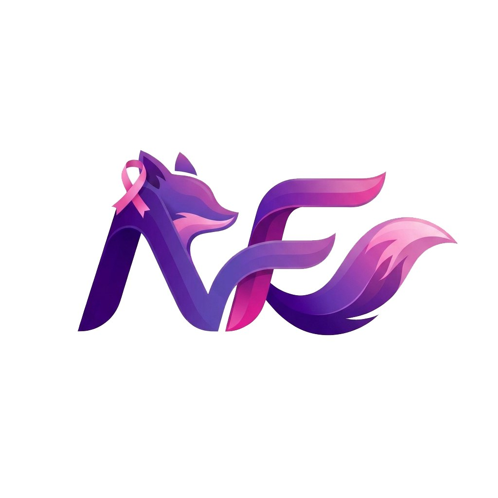

<div align="center">

<table>
  <tr>
    <td align="center" style="border: 3px solid #8B2FC9; border-radius: 20px; padding: 20px; background: #fff;">
      
    </td>
  </tr>
</table>

<br/>


<br/><br/>

# 🎮 GameOn v11

**Telegram üzerinde çok oyunculu masa oyunları botu**

[](https://python.org)
[](https://python-telegram-bot.org)
[](https://flask.palletsprojects.com)
[](.)

</div>

---

## 📖 Bot Nedir?

**GameOn**, Telegram'da çalışan bir **çok oyunculu masa oyunları botu**dur. Mini Web App arayüzü sayesinde oyuncular Telegram'ı kapatmadan birbirleriyle oda kurarak 9 farklı oyunu gerçek zamanlı oynayabilir. Bot; oda sistemi, puan tablosu, arkadaş listesi, profil & avatar, sezon sistemi ve tam donanımlı bir admin paneli ile gelir.

---

## 🕹️ Oyunlar

| Oyun | Oyuncu Sayısı | Kazanma Puanı |
|------|:---:|---|
| 🃏 **101 Okey** | 4 | 1. `5` · 2. `3` · 3. `3` · 4. `1` |
| 🃏 **Batak** | 4 | 1. `4` · 2. `2` · 3. `2` · 4. `1` |
| 🎲 **Ludo** | 2–4 | 1. `4` · 2. `2` · 3. `2` · 4. `1` |
| 🃏 **UNO** | 2–4 | 2 kişi `3/1` · 3 kişi `4/2/1` · 4 kişi `4/2/2/1` |
| ♟️ **Tavla** | 2 | 1. `4` · 2. `2` |
| ♟️ **Dama** | 2 | 1. `3` · 2. `1` |
| 🟣 **Dört Dörtlük** | 2 | 1. `3` · 2. `1` |
| ⚓ **Amiral Battı** | 2 | 1. `2` · 2. `0` |
| 🫙 **Mangala** | 2 | 1. `2` · 2. `0` |

---

## 🎯 Nasıl Oynanır?

### 1️⃣ Bota Başla
```
/start
```
"🎮 Oyunu Aç" butonuna basarak Mini Web App arayüzünü açın.

### 2️⃣ Oda Kur
1. Web arayüzünden bir oyun seçin.
2. **"Oda Kur"** butonuna basın.
3. İsteğe bağlı olarak oda şifresi belirleyebilirsiniz.

### 3️⃣ Odaya Katıl
Arkadaşlarınız `/odalar` komutuyla veya **Odalar** sayfasından açık odaları görüp katılabilir.

### 4️⃣ Oyna
Oda dolunca oyun otomatik başlar. Sırası gelen oyuncuya **DM bildirim** gönderilir.

> 💡 **Botla Oyna:** Puan olmadan, arkadaş beklemeden istediğin zaman tek başına pratik yapabilirsin!

---

## ⚙️ Özellikler

### 🏠 Oda Sistemi
- Gerçek zamanlı çok oyunculu oda desteği
- Şifreli veya açık oda kurma
- **AFK Koruma:** 20 saniye hamle yapmayan oyuncuya DM hatırlatma
- **Hükmen Mağlubiyet:** 90 saniye dönmeyen oyuncu otomatik olarak kaybeder
- Rövanş sistemi — oyun biter bitmez tekrar meydan okuyun

### 🏆 Puan & Sıralama
- Oyun sonu otomatik puan hesaplama
- **Günlük 60 puan** sınırı (kötüye kullanım koruması)
- Aynı grup günde **en fazla 3 oyundan** puan alabilir
- Çok kısa oyunlarda (süre/hamle yetersizse) puan verilmez
- Günlük & haftalık liderlik tablosu — `/siralama`
- **Sezon Sistemi:** Sezon sonu kupa ve ek puan ödülleri

### 👤 Profil & Sosyal
- Kişisel profil sayfası — `/profil`
- 10 farklı avatar seçeneği
- Arkadaş listesi, arkadaşlık isteği gönderme/kabul etme
- Oyun geçmişi ve istatistikler

### 📢 Bildirimler & Duyurular
- Yeni kullanıcılara otomatik DM duyurusu
- Admin'in gönderdiği toplu duyurular (sabitlenebilir)
- Bildirimler sayfası

### 🛡️ Admin Paneli (`/yt`)

| Özellik | Açıklama |
|---------|---------|
| 🚫 Ban / ✅ Unban | Kullanıcı ya da IP'ye süreli/kalıcı ban |
| 🚪 Oda Kapat | Aktif odayı zorla kapat |
| 👢 Oyuncuyu At | Odadan oyuncu çıkar |
| 📢 Duyuru | Herkese ya da DM ile duyuru gönder |
| 🔍 Kullanıcı Ara | ID veya kullanıcı adıyla kullanıcı detayları |
| ⭐ Puan Ver/Sil | Manuel puan düzenleme |
| 📊 İstatistik | Kayıtlı & banlı kullanıcı sayısı, oyun analizleri |
| 🏆 Sezonu Sıfırla | Yeni sezon başlat |
| 🛠 Bakım Modu | Botu geçici olarak devre dışı bırak |
| 🖥 Sunucu Durumu | Çalışma süresi, hata log'u, bağlantı durumu |
| 📨 Odaya Mesaj | Belirli bir odaya mesaj gönder |
| 🌐 Kullanıcı IP | Kullanıcının bilinen IP'lerini görüntüle |
| 💾 Yedek Al / ♻️ Geri Yükle | Tüm verileri yedekle veya zip'ten geri yükle |
| 🕵️ Şüpheli Kullanıcılar | Anomali tespit edilenleri listele |

### 🌐 Mini Web App
- Cloudflare tüneli ile otomatik açık adres (start.sh)
- Statik GitHub Pages üzerinden sunulur
- `?api=` parametresiyle sunucu adresi değişse bile web otomatik bağlanır
- Dişli menüsünden bağlantı durumu kontrolü

---

## 💬 Komutlar

| Komut | Açıklama |
|-------|---------|
| `/start` | Botu başlat, ana menüyü aç |
| `/profil` | Profilini görüntüle |
| `/siralama` | Liderlik tablosunu göster |
| `/odalar` | Açık odaları listele |
| `/destek <mesaj>` | Yöneticiye destek mesajı gönder |
| `/yardim` | Yardım ve kural rehberi |
| `/yt` | 🔒 Admin paneli *(sadece admin)* |

---

## 🚀 Kurulum

### Gereksinimler
- Python 3.10+
- Termux (Android) veya Linux sunucu
- `cloudflared` (opsiyonel, tünel için)
- GitHub Pages hesabı (web arayüzü için)

### Adımlar

**1. Web Arayüzünü Yayınla**
```
gameon-web/ klasörünü GitHub Pages'e yükle
```

**2. `.env` Dosyasını Oluştur**
```bash
cp gameon-server/.env.example gameon-server/.env
```

```env
BOT_TOKEN=123456:ABC...           # BotFather token
ADMIN_ID=123456789                # Telegram ID'n
WEBAPP_URL=https://kullanici.github.io/repo/
ALLOWED_ORIGIN=https://kullanici.github.io
SUPPORT_GROUP_LINK=https://t.me/+grup_davet_linki
DATA_DIR=/var/data                # Kalıcı disk yolu
```

**3. Bağımlılıkları Yükle**
```bash
pip install -r gameon-server/requirements.txt
```

**4. Botu Başlat**
```bash
cd gameon-server
chmod +x start.sh
./start.sh
```

> `start.sh` Cloudflare tünelini otomatik açar, adresi yakalar ve mini web'e bildirir. `config.js` düzenlemeye gerek yok.

### Güncelleme
`gameon-server/` içindeki tüm dosyaları kopyala (`core.py` ve `data/` **hariç**), `gameon-web/`'i Pages'e yükle, `./start.sh` ile başlat.

---

## 📋 Oyun Kuralları (Özet)

- ⏱ **Çok kısa oyun** → puan verilmez (her oyunun minimum süre & hamle eşiği vardır)
- 📅 **Günlük 60 puan** sınırı aşılamaz
- 👥 Aynı grup → günde **en fazla 3 oyundan** puan
- ⏰ **90 saniye** dönen yoksa → hükmen mağlubiyet
- 🔔 **20 saniye** hamle yapılmazsa → AFK DM uyarısı

---

## 🗂️ Proje Yapısı

```
gameon_v11/
├── gameon-server/
│   ├── server.py          # Telegram botu + Flask API (tek süreç)
│   ├── rooms.py           # Oda sistemi, puanlama, sıralama, arkadaşlar
│   ├── core.py            # Ortak yardımcılar, JsonStore, doğrulama
│   ├── uno.py             # UNO oyun motoru
│   ├── batak.py           # Batak oyun motoru
│   ├── backup.py          # Yedekleme & geri yükleme
│   ├── check.py           # Sistem kontrol aracı
│   ├── start.sh           # Başlatıcı (tünel + watchdog)
│   ├── .env.example       # Örnek yapılandırma
│   └── data/              # JSON veri dosyaları (kalıcı disk)
└── gameon-web/
    ├── Siralama.html      # Liderlik tablosu
    ├── Arkadaslar.html    # Arkadaşlar sayfası
    ├── Bildirimler.html   # Bildirimler
    ├── bakim.html         # Bakım modu sayfası
    └── assets/            # CSS, JS, görseller, UNO kart görselleri
```

---

<div align="center">

**Geliştirici:** [NightFox](https://github.com/) &nbsp;•&nbsp; *Elegance In Design*


*Bu proje NightFox tarafından geliştirilmiştir. Her hakkı saklıdır.*

</div>
